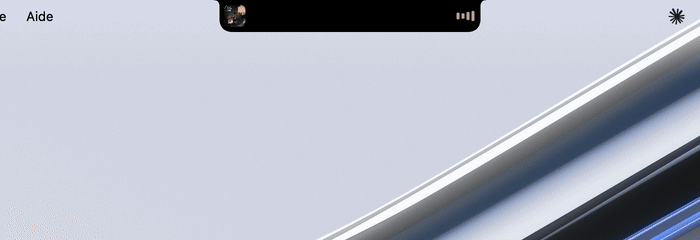
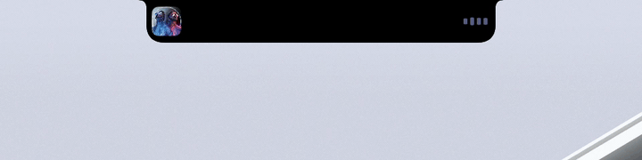
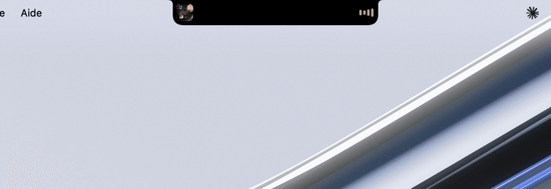
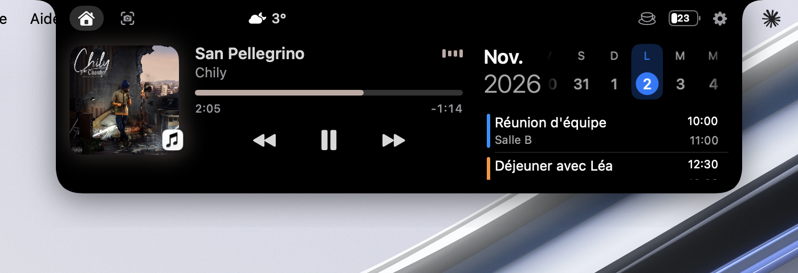
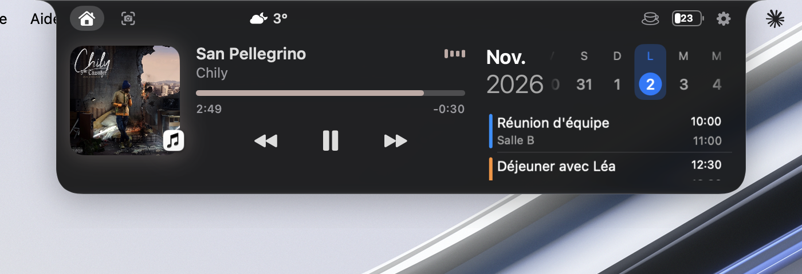
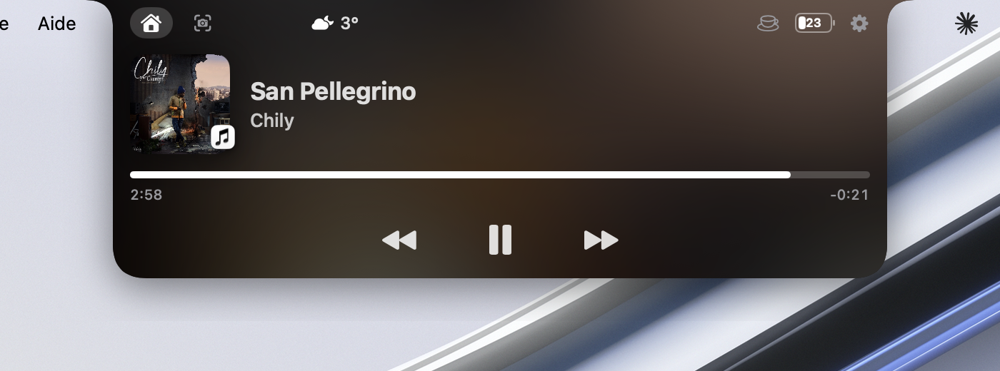
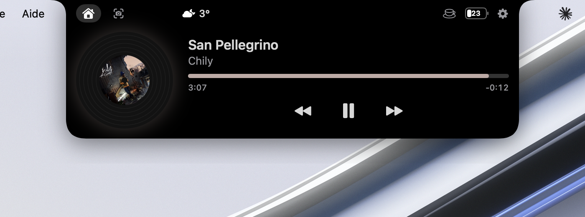
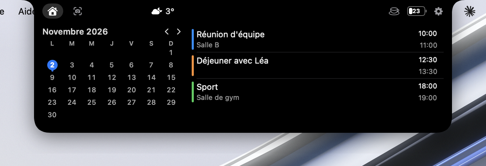
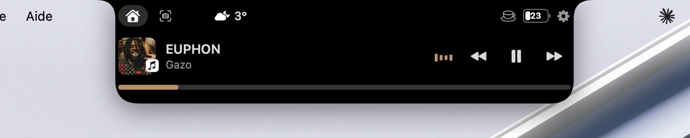
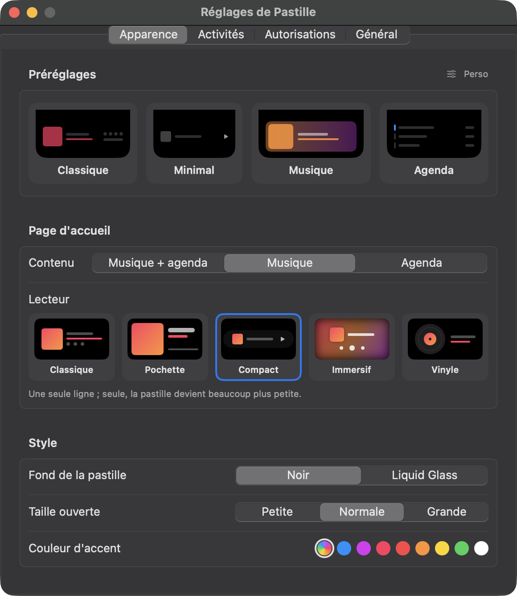

<div align="center">

# Pastille

**Une Dynamic Island pour l'encoche de ton Mac.**

Musique, agenda, minuteur, codes de vérification, batterie de tes AirPods… tout s'affiche en douceur autour de l'encoche, au bon moment.



</div>

---

## ✨ Au quotidien

### Ta musique, d'où qu'elle vienne

Musique, Spotify, Deezer, YouTube dans le navigateur… Pastille affiche la pochette et un petit spectre de chaque côté de l'encoche. Quand la chanson change, elle descend un instant pour annoncer le titre, puis remonte.



### Ouverte, tout est sous la main

Survole l'encoche : lecteur complet, frise des jours avec tes événements, météo, batterie de tes appareils Bluetooth, tasse de café pour garder le Mac éveillé.



### Les codes de vérification, sans chercher ton iPhone

Un code arrive par SMS, iMessage ou Mail ? Il s'affiche aussitôt dans la pastille. Un clic pour le copier.


### Les petits moments utiles

Appareil qui se connecte avec sa batterie, Mac branché, minuteur d'Horloge terminé, téléchargement en cours, volume et luminosité… Des apparitions courtes, qui s'enchaînent sans jamais se marcher dessus.


---

## 🎨 Fais-la à ton goût

Préréglages en un clic, cinq styles de lecteur, trois styles d'agenda, fond **Noir** ou **Liquid Glass**, taille, couleur d'accent, et chaque activité activable ou non.

| Classique | Liquid Glass |
|:---:|:---:|
|  |  |
| **Immersif** | **Vinyle** |
|  |  |
| **Agenda du mois** | **Compact** |
|  |  |

<div align="center">

</div>

---

## 🧩 Tout ce que fait Pastille

| | |
|---|---|
| 🎵 **Musique** | Toutes les apps (« À l'écoute » de macOS), priorité à la musique sur les vidéos, commandes, annonce du nouveau morceau |
| 📅 **Agenda** | Frise des jours, liste de la semaine ou mois complet |
| ⏱️ **Horloge** | Minuteur et chronomètre de l'app Horloge, en direct |
| 🔑 **Codes** | Codes de vérification reçus par SMS, iMessage ou Mail, copiés en un clic |
| 🎧 **Bluetooth** | Batterie des AirPods et casques (même Sennheiser, Sony…), animation à la connexion |
| 🔋 **Batterie** | Pourcentage dans l'icône, alertes à 20 / 10 / 5 %, animation de charge |
| 🔊 **Volume & luminosité** | Remplace l'indicateur de macOS, icône casque ou AirPods selon la sortie |
| ⬇️ **Téléchargements** | Anneau de progression, puis un clic pour ouvrir le fichier |
| 📸 **Captures d'écran** | Onglet dédié : copier, glisser, mettre à la corbeille |
| ☕ **Café** | Garde le Mac éveillé |
| 🌤️ **Météo** | Température et illustration à ta position |
| 🖥️ **Plein écran** | Se replie et s'efface pendant les vidéos et les jeux |

Léger : environ **0 %** de CPU au repos, **1 %** avec la musique.

---

## 🚀 Installation

**Prérequis** : un Mac avec macOS 14 (Sonoma) ou plus récent. Liquid Glass demande macOS 26.

```bash
git clone https://github.com/Zeky69/Pastille.git
cd Pastille
./build.sh install
```

`build.sh install` lance d'abord les tests (`swift test`), puis compile Pastille, l'installe dans `/Applications` et la lance. Si un test échoue, rien n'est installé.

Au premier lancement, macOS demande quelques autorisations. Chacune ne sert qu'à une fonction, et l'onglet **Réglages › Autorisations** montre leur état avec un raccourci pour les accorder :

| Autorisation | Pour |
|---|---|
| Accessibilité | Remplacer l'indicateur de volume et de luminosité, détecter le plein écran |
| Surveillance de l'entrée | Repérer les touches de volume et de luminosité |
| Accès complet au disque | Lire les codes dans Messages et Mail |
| Calendrier, Localisation, Bluetooth | Agenda, météo, batterie des appareils |

> Tout est lu **en local**. Pastille n'envoie rien, sauf des coordonnées arrondies (~1 km) au service météo Open-Meteo.

---

## ⚠️ À savoir

Plusieurs fonctions passent par des chemins non officiels de macOS (« À l'écoute », luminosité, minuteur d'Horloge, batterie des casques). C'est pour ça que Pastille n'est pas sur l'App Store, et qu'une mise à jour de macOS peut en casser une : elle s'affiche alors en orange dans **Réglages › Autorisations**, et le reste continue de marcher.

Inspirée de [boring.notch](https://github.com/TheBoredTeam/boring.notch).

---

<div align="center">

Sous licence [MIT](LICENSE).

</div>
