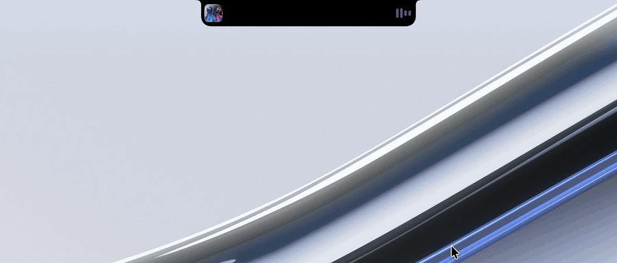
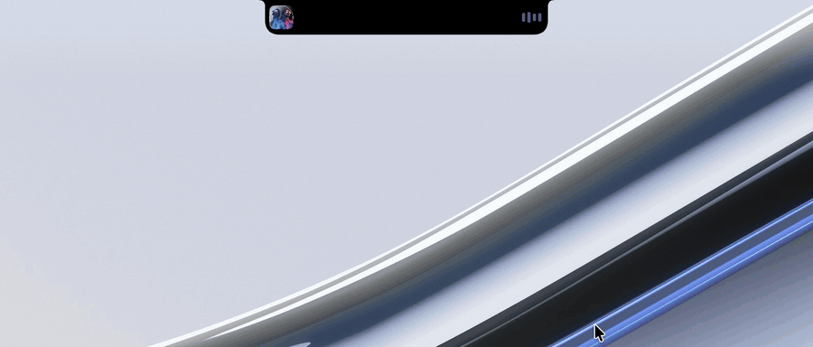

<div align="center">

# Pastille

**Une Dynamic Island pour l'encoche des MacBook.**

Pastille transforme l'encoche de l'écran en espace utile : musique en cours, agenda, minuteurs, codes de vérification, batterie des appareils Bluetooth. L'information apparaît au bon moment, puis s'efface.

[](https://github.com/Zeky69/Pastille/releases/latest)
[](#configuration-requise)
[](https://www.swift.org)
[](LICENSE)

**[Télécharger la dernière version](https://github.com/Zeky69/Pastille/releases/latest)** · [Installation](#installation) · [Fonctionnalités](#fonctionnalités)



</div>

## Sommaire

- [Fonctionnalités](#fonctionnalités)
- [Personnalisation](#personnalisation)
- [Installation](#installation)
- [Premier lancement](#premier-lancement)
- [Mises à jour](#mises-à-jour)
- [Désinstallation](#désinstallation)
- [Confidentialité](#confidentialité)
- [Limites connues](#limites-connues)
- [Développement](#développement)
- [Licence](#licence)

## Fonctionnalités

### Lecture en cours

Pastille affiche la pochette et un spectre animé de part et d'autre de l'encoche, quelle que soit l'application : Musique, Spotify, Deezer, ou une vidéo YouTube dans le navigateur. À chaque changement de morceau, la pastille s'agrandit brièvement pour annoncer le titre. Cette annonce peut être limitée aux changements faits par l'utilisateur.


### Vue détaillée au survol

Il suffit de placer le curseur sur l'encoche pour ouvrir la pastille. Elle regroupe le lecteur complet, les événements du jour, la météo, la batterie des appareils Bluetooth et un mode qui empêche la mise en veille du Mac. Elle se referme dès que le curseur s'éloigne.



### Codes de vérification

Les codes reçus par SMS, iMessage ou Mail s'affichent immédiatement dans la pastille, accompagnés du nom du service quand il est reconnu. Un clic copie le code.


### Notifications d'état

Connexion d'un appareil Bluetooth avec son niveau de batterie, branchement du chargeur, fin d'un minuteur, téléchargement en cours, réglage du volume ou de la luminosité. Ces notifications sont brèves et passent l'une après l'autre, sans jamais se chevaucher.


### Liste complète

| Domaine | Détail |
|---|---|
| Musique | Toutes les applications via « À l'écoute » de macOS, priorité à la musique sur les vidéos, commandes de lecture, annonce du morceau suivant |
| Agenda | Frise des jours, liste de la semaine ou vue du mois |
| Horloge | Minuteur et chronomètre de l'application Horloge, en temps réel |
| Codes de vérification | SMS, iMessage et Mail, copie en un clic |
| Bluetooth | Batterie des AirPods et des casques tiers (Sennheiser, Sony…), notification à la connexion |
| Batterie | Pourcentage, alertes à 20, 10 et 5 %, notification de charge |
| Volume et luminosité | Remplace l'indicateur de macOS, avec l'icône de la sortie audio utilisée |
| Téléchargements | Progression, vitesse, puis ouverture du fichier d'un clic |
| Captures d'écran | Onglet dédié : copier, glisser-déposer, mettre à la corbeille |
| Veille | Maintient le Mac éveillé à la demande |
| Météo | Température et conditions à la position actuelle |
| Plein écran | La pastille se retire pendant les vidéos, jeux et présentations |

Pastille est légère : environ 0 % de processeur au repos et 1 % pendant la lecture de musique.

## Personnalisation

Des préréglages permettent de changer d'apparence en un clic. Chaque élément peut aussi être ajusté séparément : cinq styles de lecteur, trois styles d'agenda, fond Noir ou Liquid Glass, taille, couleur d'accent, et activation de chaque notification.

| Classique | Liquid Glass |
|:---:|:---:|
|  |  |
| **Immersif** | **Vinyle** |
|  |  |
| **Agenda du mois** | **Compact** |
|  |  |

<div align="center">

</div>

## Installation

### Configuration requise

- Un MacBook à encoche (puce Apple).
- macOS 14 Sonoma ou plus récent. Le fond Liquid Glass nécessite macOS 26.

### Option 1 : télécharger l'application (recommandé)

1. Téléchargez le fichier `Pastille-<version>.zip` depuis la page [Releases](https://github.com/Zeky69/Pastille/releases/latest).
2. Ouvrez l'archive, puis glissez **Pastille** dans le dossier **Applications**.
3. Ouvrez le Terminal et exécutez la commande suivante :

   ```bash
   xattr -dr com.apple.quarantine /Applications/Pastille.app
   ```

4. Lancez Pastille depuis le dossier Applications.

**Pourquoi l'étape 3 ?** Pastille n'est pas notariée par Apple, une démarche qui nécessite un compte développeur payant. macOS bloque donc toute application téléchargée qui n'a pas été notariée. Cette commande retire uniquement l'indicateur « téléchargé depuis Internet » de Pastille, et ne modifie aucun réglage de sécurité du système.

Il est aussi possible d'autoriser l'application dans **Réglages Système › Confidentialité et sécurité › Ouvrir quand même**. Dans ce cas, l'affichage de la musique des navigateurs et des applications autres que Musique et Spotify ne fonctionnera pas : la commande ci-dessus reste nécessaire.

### Option 2 : compiler depuis les sources

Nécessite Xcode 26 ou plus récent.

```bash
git clone https://github.com/Zeky69/Pastille.git
cd Pastille
./build.sh install
```

Le script exécute les tests, compile l'application, l'installe dans `/Applications` puis la lance. Si un test échoue, rien n'est installé.

## Premier lancement

Pastille s'installe dans la barre des menus et ne demande que les autorisations nécessaires aux fonctions utilisées. Chacune peut être accordée plus tard. L'onglet **Réglages › Autorisations** affiche leur état et un raccourci vers le réglage correspondant de macOS.

| Autorisation | Utilisation |
|---|---|
| Accessibilité | Remplacer l'indicateur de volume et de luminosité, détecter le plein écran |
| Surveillance de l'entrée | Reconnaître les touches de volume et de luminosité |
| Accès complet au disque | Lire les codes de vérification dans Messages et Mail |
| Calendrier | Afficher les événements |
| Localisation | Afficher la météo locale |
| Bluetooth | Lire la batterie des appareils connectés |

Pour lancer Pastille à l'ouverture de session, activez l'option dans **Réglages › Général**.

## Mises à jour

Pastille recherche les nouvelles versions au lancement, puis toutes les six heures. Lorsqu'une version est disponible, elle l'annonce dans la pastille. L'installation se lance d'un clic dans **Réglages › Général › Mises à jour** ou depuis l'icône de la barre des menus. L'application est ensuite remplacée et relancée, et les autorisations accordées sont conservées.

Chaque version publiée est signée (Ed25519). Pastille vérifie cette signature avant toute installation, et refuse les archives non signées ou modifiées. La recherche automatique peut être désactivée dans les réglages.

## Désinstallation

1. Quittez Pastille depuis l'icône de la barre des menus.
2. Supprimez `Pastille.app` du dossier Applications.
3. Facultatif : supprimez les préférences avec la commande suivante.

   ```bash
   defaults delete com.macky.pastille
   ```

Les autorisations accordées peuvent être retirées dans **Réglages Système › Confidentialité et sécurité**.

## Confidentialité

Toutes les données sont lues et traitées localement : messages, mails, agenda, musique, appareils. Pastille ne collecte aucune donnée et n'utilise aucun service d'analyse. Seules deux requêtes réseau sont effectuées :

- **Météo** : des coordonnées arrondies à environ 1 km sont envoyées à [Open-Meteo](https://open-meteo.com).
- **Mises à jour** : une requête vers l'API GitHub vérifie la dernière version publiée. Elle peut être désactivée.

## Limites connues

Certaines fonctions s'appuient sur des interfaces non documentées de macOS : lecture en cours de toutes les applications, luminosité, minuteur de l'application Horloge, batterie des casques tiers. Pour cette raison, Pastille ne peut pas être distribuée sur l'App Store. Une mise à jour de macOS peut aussi rendre l'une de ces fonctions indisponible. Elle apparaît alors en orange dans **Réglages › Autorisations**, et le reste de l'application continue de fonctionner.

## Développement

### Structure du projet

```
Sources/Pastille/
├── App/          Lancement, réglages, apparence, diagnostic
├── Managers/     Sources de données : musique, agenda, codes, Bluetooth, mises à jour…
├── Pill/         Fenêtre, forme animée et logique d'affichage de la pastille
└── Views/        Interface SwiftUI (Compact, Expanded, Music, Calendar, Settings, Devices)
Tests/PastilleTests/   Tests unitaires (Swift Testing)
Support/               Info.plist, icône, lecteur « À l'écoute », signature des versions
```

### Tests

```bash
swift test
```

Les tests couvrent la détection des codes, la lecture des mails, la protection contre l'injection AppleScript, les minuteurs, la file des notifications et la vérification des mises à jour. `build.sh` les exécute avant chaque compilation.

### Publier une version

1. Mettez à jour `CFBundleShortVersionString` dans `Support/Info.plist`, puis rédigez les notes dans `docs/releases/<version>.md`.
2. Commitez et poussez les modifications.
3. Exécutez `./build.sh publish`. Le script lance les tests, compile, crée l'archive signée, puis publie la release sur GitHub avec `gh`.

La signature utilise la clé privée `~/.config/pastille/update-signing-key`, créée au premier `./build.sh release`. Cette clé ne doit jamais être ajoutée au dépôt. Conservez-en une copie de sauvegarde : sans elle, les installations existantes refuseront les versions suivantes.

## Licence

Distribué sous licence [MIT](LICENSE). Inspiré de [boring.notch](https://github.com/TheBoredTeam/boring.notch).
